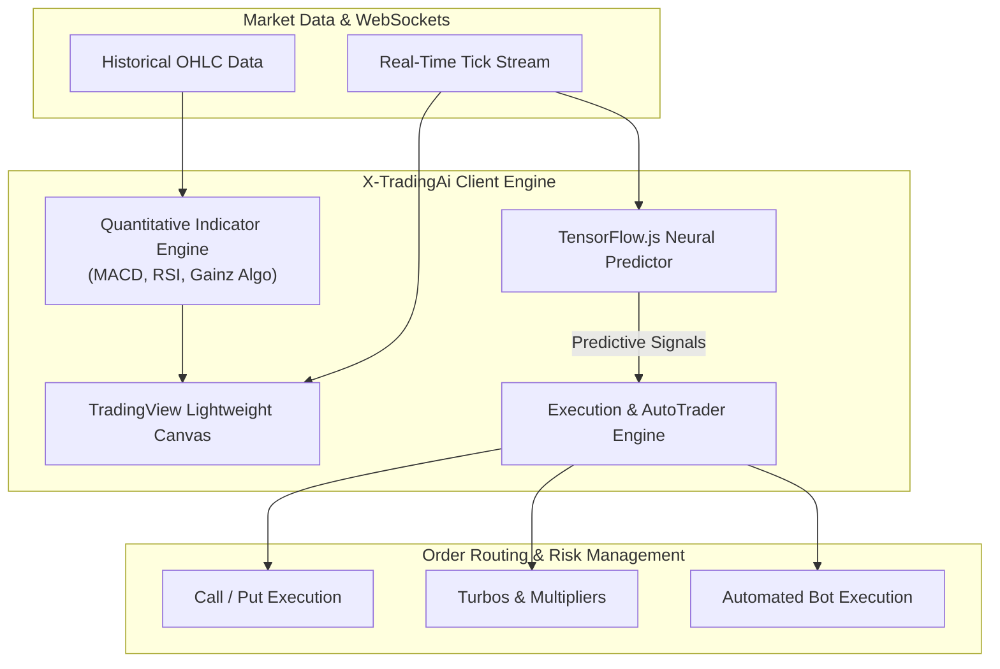

# ⚡ X-TradingAi — Next-Gen AI Algorithmic Trading Platform

<div align="center">

  [](https://app.xtradingai.com/)
  [](https://react.dev/)
  [](https://www.tensorflow.org/js)
  [](https://www.tradingview.com/lightweight-charts/)
  [](https://tailwindcss.com/)
  [](https://www.radix-ui.com/)
  [](LICENSE)

  <p align="center">
    A high-frequency algorithmic trading web application combining real-time financial charting, on-device machine learning price forecasting powered by <strong>TensorFlow.js</strong>, automated script-based execution, and quantitative indicator analytics.
  </p>

  <p align="center">
    <a href="#-key-features">Key Features</a> •
    <a href="#-architecture">Architecture</a> •
    <a href="#-tech-stack">Tech Stack</a> •
    <a href="#-modules--panels">Modules</a> •
    <a href="#-getting-started">Getting Started</a> •
    <a href="#-author">Author</a>
  </p>

</div>

---

## 🌟 Overview

**X-TradingAi** is an advanced trading platform engineered for synthetic indices, cryptocurrencies, and forex markets. Built from the ground up for sub-millisecond chart responsiveness and algorithmic strategy automation, it empowers traders with automated bot execution, machine-learning market direction predictions, and high-precision technical indicators.

- 🌐 **Live Application**: [app.xtradingai.com](https://app.xtradingai.com/)
- 🌐 **Landing Page**: [xtradingai.com](https://xtradingai.com)

---

## ✨ Key Features

- **📈 High-Performance Financial Charts**:
  - Powered by **TradingView Lightweight Charts** and **Chart.js** financial candles.
  - Interactive candlestick, Heikin-Ashi, and area charts with real-time tick streaming and zero lag.
  - Drawing tools, horizontal ray markers, trend lines, and custom indicators overlay.
- **🤖 Client-Side Machine Learning (TensorFlow.js)**:
  - Deep neural network price forecasting running directly in the browser via WebGL acceleration.
  - Real-time probability scoring for Bullish vs Bearish trend continuations and volatility reversals.
- **⚡ Automated Trading Bots & Script Runner**:
  - **AutoTrader Panel**: Rule-based bot execution (Martingale, D'Alembert, Compound Profit).
  - **Script Runner**: Custom strategy scripting and automated backtesting against historical tick data.
- **📊 Quantitative Technical Indicators**:
  - Built-in mathematical compute engines for MACD, RSI, Bollinger Bands, EMA/SMA cross, Stochastic Oscillators, and the proprietary *Gainz Algo*.
- **🎯 Multi-Type Execution Engine**:
  - High-precision execution for Call/Put options, Turbos, Multipliers, and Digits Analysis (Odd/Even, Matches/Differs, Over/Under).
- **📱 Responsive & Touch-Optimized Layout**:
  - Desktop multi-window workspace with floating trade selector.
  - Mobile-first trade carousel and collapsible drawer interface.

---

## 🏛️ Architecture & Data Flow



---

## 🛠️ Tech Stack

| Layer | Technologies |
| :--- | :--- |
| **Frontend Framework** | **React 18**, **Vite** (ESM bundler) |
| **Machine Learning** | **@tensorflow/tfjs** (Client-side GPU/WebGL neural compute) |
| **Data Visualization** | **TradingView Lightweight Charts v5**, **ApexCharts**, **Chart.js Financial** |
| **UI Components & Styling** | **Tailwind CSS**, **Radix UI Primitives**, **Framer Motion**, **Lucide Icons** |
| **Mathematical Libraries** | **D3-Format**, **D3-Time-Format**, **Date-Fns** |
| **Routing & Optimization** | **React Router DOM v7**, **use-debounce** |

---

## 📂 Project Structure

```text
tradingApp-main/
├── public/                               # Static assets & public icons
├── src/
│   ├── App.jsx                           # Core state orchestrator & layout container
│   ├── main.jsx                          # React application entry
│   ├── index.css                         # Custom trading theme styles
│   ├── contexts/                         # Market context, user auth, trade states
│   ├── hooks/                            # WebSocket tick subscriptions, window size hooks
│   ├── lib/                              # Utility helpers & class merger (clsx/tailwind-merge)
│   └── components/
│       ├── TradingChart.jsx              # Lightweight TradingView chart engine
│       ├── ChartArea.jsx                 # Resizable chart container & tools toolbar
│       ├── PredictionPanel.jsx           # TensorFlow.js AI price forecast panel
│       ├── AutoTraderPanel.jsx           # Automated bot trading controller
│       ├── ScriptRunnerPanel.jsx         # Custom script strategy runner
│       ├── DigitsAnalysisPanel.jsx       # Real-time digits frequency & statistics
│       ├── CallPutExecution.jsx          # High/Low & Rise/Fall execution
│       ├── TurbosExecution.jsx           # Turbos contract parameters & trade dispatch
│       ├── MarketSelector.jsx            # Multi-asset ticker selection dropdown
│       ├── DrawingToolsModal.jsx         # Technical analysis drawing overlay
│       └── indicators.js                 # Pure mathematical formulas for indicators
├── tailwind.config.js                    # Custom trading dark palette & animations
├── package.json                          # Dependencies & NPM scripts
└── vite.config.js                        # Bundler plugins & dev proxy configuration
```

---

## 🚀 Getting Started

### Prerequisites

- **Node.js**: v18.0.0 or higher ([Download Node.js](https://nodejs.org/))
- **npm** or **yarn**

### Installation

1. **Clone the repository**:
   ```bash
   git clone https://github.com/SupunNethsara/X-TradingAi.git
   cd X-TradingAi
   ```

2. **Install dependencies**:
   ```bash
   npm install
   ```

3. **Start the development server**:
   ```bash
   npm run dev
   ```
   Open `http://localhost:3000` to interact with the platform.

4. **Build for production**:
   ```bash
   npm run build
   ```

---

## 👨‍💻 Author & Connect

**Supun Dharmathilaka (Supun Nethsara)**  
*Associate Team Lead Software Engineer & Full Stack Developer*

- 🌐 **Portfolio**: [supunnethsaradev.netlify.app](https://supunnethsaradev.netlify.app/)
- 💼 **LinkedIn**: [linkedin.com/in/supun-dharmathilaka](https://www.linkedin.com/in/supun-dharmathilaka-a64389257/)
- 🐙 **GitHub**: [@SupunNethsara](https://github.com/SupunNethsara)
- 📧 **Email**: [supundarmathilaka@gmail.com](mailto:supundarmathilaka@gmail.com)

---

## 📄 License

This project is licensed under the [MIT License](LICENSE).
